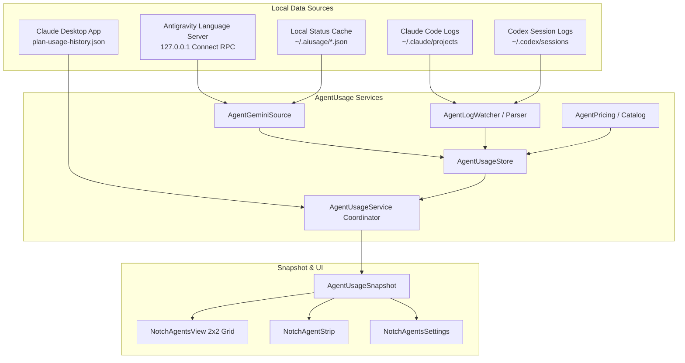

# Integration Plan: AI Usage Tracker with Gemini & Antigravity (AGY)

## 1. Executive Summary & Objective

The goal is to merge the session/weekly quota tracking capabilities from [`/Users/aadismacbookair/Local_Codebase/ai-usage-bar`](file:///Users/aadismacbookair/Local_Codebase/ai-usage-bar) into the **Vorssaint macOS Dynamic Island** AI page (`vorssaint-macos`).

### Key Goals:
1. **Expand Providers from 2 to 4**:
   - Currently: **Claude**, **Codex**.
   - Target: **Claude**, **Gemini**, **AGY (Antigravity)**, **Codex**.
   - **Strict Order**: `claude` $\rightarrow$ `gemini` $\rightarrow$ `agy` $\rightarrow$ `codex`.
2. **Top Limit Cards (4-Provider Grid)**:
   - Instead of 2 limit cards (Claude & Codex), render a clean **2×2 grid of 4 provider limit cards** at the top of the AI page.
   - Each card displays both **Next 5 Hours** (`5h`) and **This Week** (`weekly`) quota allowance bars, remaining/used percentages, reset countdowns, and urgency coloring.
3. **Retain All Existing Financial & Analytics Metrics**:
   - Preserve all dollar calculations: equivalent API dollar spend, total tokens, cache dollar savings, 30-day plan multiples, and multi-provider proportional split bar in the **Spend Card**.
   - Preserve the **Trend Card** (hourly/daily spend/tokens), **Live Card** (active turn progress), **Models & Projects Share Cards**, and the **13-Week Activity Heatmap**.
4. **Zero-Telemetry Local Sourcing**:
   - Ingest quota directly from the local Antigravity Language Server loopback RPC (`POST /exa.language_server_pb.LanguageServerService/RetrieveUserQuotaSummary`) and local cache files (`~/.aiusage/gemini.json`, `~/.aiusage/antigravity.json`).

---

## 2. Target Final Output & UI Layout

### A. Dynamic Island Expanded View (`NotchAgentsView`)

```text
┌────────────────────────────────────────────────────────────────────────┐
│  AI / Coding Agents                                                    │
├───────────────────────────────────┬────────────────────────────────────┤
│ [✳] Claude                [Pro] • │ [✦] Gemini                 [1.5] • │
│ Next 5 hours     resets at 8:30 PM│ Next 5 hours     resets at 8:44 PM │
│ ━━━━━━━▭▭▭▭▭▭▭▭▭▭▭▭▭▭▭▭       20% │ ━━▭▭▭▭▭▭▭▭▭▭▭▭▭▭▭▭▭▭▭▭          5% │
│ This week      resets Tue, 9:30 AM│ This week       resets Sat, 3:12 AM│
│ ━━━━━━▭▭▭▭▭▭▭▭▭▭▭▭▭▭▭▭▭       19% │ ━━━━━━━━━━━━▭▭▭▭▭▭▭▭▭▭▭        38% │
├───────────────────────────────────┼────────────────────────────────────┤
│ [∧] Antigravity           [3P] •  │ [⠶] Codex                 [Plus] • │
│ Next 5 hours     resets at 9:43 PM│ Session          resets in 2 hr    │
│ ▭▭▭▭▭▭▭▭▭▭▭▭▭▭▭▭▭▭▭▭▭▭▭        0% │ ━━━━━━━▭▭▭▭▭▭▭▭▭▭▭▭▭▭▭▭       22% │
│ This week      resets Wed, 4:01 PM│ Weekly           resets in 4 d     │
│ ▭▭▭▭▭▭▭▭▭▭▭▭▭▭▭▭▭▭▭▭▭▭▭        0% │ ━━━━━━━━━▭▭▭▭▭▭▭▭▭▭▭▭▭▭       31% │
├───────────────────────────────────┴────────────────────────────────────┤
│ [S] Spend Card                                                [Today ▾]│
│     ≥ $24.80 API value                               3.4× Pro  1.8× AGY│
│     [══ Claude ══][== Gemini ==][= AGY =][==== Codex ====]             │
│     1.4M tokens · 78% cached · $12.30 saved                            │
├───────────────────────────────────┬────────────────────────────────────┤
│ [~] Live Activity                 │ [C] Models                         │
│     [✦] Gemini · vorssaint-macos  │     Claude 3.7 Sonnet        $14.20│
│     03:24 · Gemini 2.5 Pro · 820T │     Gemini 2.5 Pro            $6.10│
├───────────────────────────────────┴────────────────────────────────────┤
│ [T] 7-Day Trend (Hourly / Daily Bars)                                  │
│     Cost ($) or Tokens per bar with hover inspection                   │
├────────────────────────────────────────────────────────────────────────┤
│ [M] 13-Week Activity Heatmap (GitHub-style streak & busiest day stats) │
└────────────────────────────────────────────────────────────────────────┘
```

### B. Provider Styling & Branding

| Provider | Enum Case | Display Name | Accent Tint | Mark / Symbol | Data Source |
| :--- | :--- | :--- | :--- | :--- | :--- |
| **Claude** | `.claude` | `Claude` | Clay (`#D87857`) | `sparkle` / Claude logo | Claude App `plan-usage-history.json` + `~/.claude/projects/` |
| **Gemini** | `.gemini` | `Gemini` | Google Blue (`#7AA8F8`) | `sparkles` / Gemini logo | Antigravity Language Server RPC / `~/.aiusage/gemini.json` |
| **AGY** | `.agy` | `Antigravity` | Neutral Slate (`#9AA0A6`) | `triangle` / AGY logo | Antigravity Language Server RPC / `~/.aiusage/antigravity.json` |
| **Codex** | `.codex` | `Codex` | OpenAI Blue (`#7D9AFF`) | `chevron.left.forwardslash.chevron.right` | `~/.codex/sessions/` |

---

## 3. Data Flow & Integration Architecture



---

## 4. File-by-File Implementation Plan

### Step 1: Core Models & Provider Enum
**File**: `Sources/Vorssaint/Services/AgentUsage/AgentUsageModels.swift`
* Update `AgentProvider` to:
  ```swift
  enum AgentProvider: String, CaseIterable, Identifiable, Codable {
      case claude, gemini, agy, codex
  }
  ```
* Update `displayName`:
  - `.claude` $\rightarrow$ `"Claude"`
  - `.gemini` $\rightarrow$ `"Gemini"`
  - `.agy` $\rightarrow$ `"Antigravity"`
  - `.codex` $\rightarrow$ `"Codex"`
* Update `symbol`:
  - `.claude` $\rightarrow$ `"sparkle"`
  - `.gemini` $\rightarrow$ `"sparkles"`
  - `.agy` $\rightarrow$ `"triangle"`
  - `.codex` $\rightarrow$ `"chevron.left.forwardslash.chevron.right"`

### Step 2: Port Gemini & Antigravity Quota Ingestion
**New File**: `Sources/Vorssaint/Services/AgentUsage/AgentGeminiSource.swift`
* Port the robust discovery, local trust handling, and RPC parser from `/Users/aadismacbookair/Local_Codebase/ai-usage-bar/Sources/AIUsageBar/GeminiSource.swift`:
  - `LocalTrustDelegate`: Validates self-signed TLS certificates exclusively on loopback (`127.0.0.1`, `::1`, `localhost`).
  - `discoverEndpoints()`:
    1. Reads `~/.aiusage/antigravity.json` if available.
    2. Runs `/bin/ps -axo pid=,args=` to discover running `language_server` instances with `--csrf_token` and `--https_server_port`.
    3. Falls back to `/usr/sbin/lsof` to find active listening TCP ports for the process.
  - `readCached()`: Ingests `~/.aiusage/gemini.json` if the language server is temporarily unreachable.
  - `parse(_ groups:)`: Maps returned buckets into Vorssaint's `AgentLimitWindow`:
    - `id.hasPrefix("gemini")` $\rightarrow$ `.gemini`
    - `id.hasPrefix("3p")` or other $\rightarrow$ `.agy`
    - Window `"5h"` $\rightarrow$ `.session` (300 min)
    - Window `"weekly"` $\rightarrow$ `.weekly` (10,080 min)
    - `usedFraction = 1.0 - remainingFraction`
    - `resetsAt`: Parsed from ISO8601 date string.

### Step 3: Integrate with `AgentUsageService`
**File**: `Sources/Vorssaint/Services/AgentUsage/AgentUsageService.swift`
* Add an instance of `AgentGeminiSource`.
* In `tickTimer()`, invoke `geminiSource.fetch { [weak self] snapshot in ... }`.
* When limits are retrieved for `.gemini` and `.agy`, update `store.limits[.gemini]` and `store.limits[.agy]`.
* Register `.gemini` and `.agy` in `snapshot.seen` so they appear in `providers`.

### Step 4: UI Styling, Marks & Visual Hierarchy
**File**: `Sources/Vorssaint/UI/Notch/NotchAgentComponents.swift`
* Update `AgentProvider.tint`:
  - `.claude`: `Color(red: 0.85, green: 0.47, blue: 0.34)`
  - `.gemini`: `Color(red: 0.48, green: 0.66, blue: 0.97)`
  - `.agy`: `Color(red: 0.60, green: 0.63, blue: 0.65)`
  - `.codex`: `Color(red: 0.49, green: 0.60, blue: 1.0)`
* Add brand mark assets or vector paths for Gemini and Antigravity in `AgentMarks.lookUp`.

### Step 5: Layout Grid in `NotchAgentsView` & `NotchAgentSupport`
**Files**: 
* `Sources/Vorssaint/Services/Notch/NotchAgentSupport.swift`
* `Sources/Vorssaint/UI/Notch/NotchAgentsView.swift`
* Update provider list in `NotchAgentsView`:
  ```swift
  @AppStorage(DefaultsKey.notchAgentsClaude) private var claude = true
  @AppStorage(DefaultsKey.notchAgentsGemini) private var gemini = true
  @AppStorage(DefaultsKey.notchAgentsAgy) private var agy = true
  @AppStorage(DefaultsKey.notchAgentsCodex) private var codex = true

  private var providers: [AgentProvider] {
      [claude ? AgentProvider.claude : nil,
       gemini ? .gemini : nil,
       agy ? .agy : nil,
       codex ? .codex : nil].compactMap { $0 }
          .filter(usage.snapshot.seen.contains)
  }
  ```
* Because `NotchAgentSupport.rows` pairs cards 2 per row when width $\ge 390\text{ pt}$, the 4 limit cards automatically arrange into a 2×2 grid:
  - Row 1: `[ Claude, Gemini ]`
  - Row 2: `[ AGY, Codex ]`
* Ensure the reset formatters in `NotchAgentLimitsCard` support both clock times (`resets at 8:30 PM`) and relative durations (`resets in 18 min`).

### Step 6: Settings & Persistence
**Files**:
* `Sources/Vorssaint/Core/Defaults.swift`
* `Sources/Vorssaint/UI/Settings/NotchAgentsSettings.swift`
* Add defaults keys:
  - `DefaultsKey.notchAgentsGemini = "notchAgentsGemini"` (default: `true`)
  - `DefaultsKey.notchAgentsAgy = "notchAgentsAgy"` (default: `true`)
* In `NotchAgentsSettingsControls`, add toggle rows for Gemini and Antigravity alongside Claude and Codex.

---

## 5. Verification & Acceptance Criteria

1. **Top Grid Layout**:
   - Dynamic Island displays 4 distinct limit cards in order: **Claude**, **Gemini**, **Antigravity**, **Codex**.
   - Each card displays both 5-hour and weekly progress bars with accurate percentages.
2. **Dynamic Island Closed Strip**:
   - Active turn status, elapsed clock, and burn rates reflect correctly when any of the 4 agents are working.
3. **Financial Tracking Preserved**:
   - Spend Card shows combined API value ($), total tokens, cache hit rates, and dollar savings.
   - The multi-colored proportional split bar displays colored segments for all active providers.
4. **Settings Toggles**:
   - Disabling Gemini or AGY in Settings immediately removes their card from the island without breaking layout pairing.
5. **Resilience & Fallbacks**:
   - If Antigravity IDE is closed, Gemini & AGY cards gracefully display `"Antigravity isn't running"` or show last known cached readings with dimmed stale indicators, exactly like `ai-usage-bar`.

---

## 6. Build & Sandboxing Notes for Implementing Agents

* When compiling with `swiftc` or running `./build.sh --test` in sandboxed terminal environments, Clang module cache and temporary directories must be redirected to the workspace:
  ```bash
  mkdir -p build/tmp build/module-cache
  export TMPDIR="$PWD/build/tmp"
  export CLANG_MODULE_CACHE_PATH="$PWD/build/module-cache"
  ```
* Standard dev build: `./build.sh --dev`
* Full test suite: `./build.sh --test`
